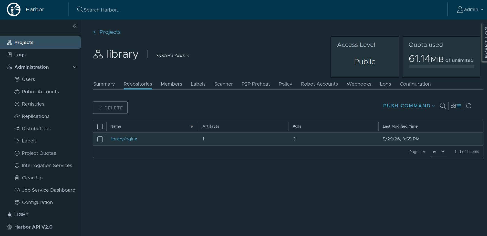

# Installation and Configuration 
 
First, update __/etc/hosts__ with __argocd.local__ domain.

```
127.0.0.1 localhost
127.0.0.1 k3d-myregistry.local
127.0.0.1 gitea.local
127.0.0.1 argocd.local
127.0.0.1 harbor.local

# The following lines are desirable for IPv6 capable hosts
::1     ip6-localhost ip6-loopback
fe00::0 ip6-localnet
ff00::0 ip6-mcastprefix
ff02::1 ip6-allnodes
ff02::2 ip6-allrouters
```

then add helm repo, and get configuration values:

```
helm repo add harbor https://helm.goharbor.io
helm repo update
helm show values gitea-charts/gitea > custom-values.yaml
```

configure for ingress, disable tls and set external url (http://harbor.local)

```yaml
expose:
  # Set how to expose the service. Set the type as "ingress", "clusterIP", "nodePort", "loadBalancer" or "route"
  # and fill the information in the corresponding section
  type: ingress
  tls:
    # Enable TLS or not.
    # Delete the "ssl-redirect" annotations in "expose.ingress.annotations" when TLS is disabled and "expose.type" is "ingress"
    # Note: if the "expose.type" is "ingress" and TLS is disabled,
    # the port must be included in the command when pulling/pushing images.
    # Refer to https://github.com/goharbor/harbor/issues/5291 for details.
    enabled: false
    # The source of the tls certificate. Set as "auto", "secret"
    # or "none" and fill the information in the corresponding section
    # 1) auto: generate the tls certificate automatically
    # 2) secret: read the tls certificate from the specified secret.
    # The tls certificate can be generated manually or by cert manager
    # 3) none: configure no tls certificate for the ingress. If the default
    # tls certificate is configured in the ingress controller, choose this option
    certSource: auto
    auto:
      # The common name used to generate the certificate, it's necessary
      # when the type isn't "ingress"
      commonName: ""
    secret:
      # The name of secret which contains keys named:
      # "tls.crt" - the certificate
      # "tls.key" - the private key
      secretName: ""
  ingress:
    hosts:
      core: harbor.local
    # set to the type of ingress controller if it has specific requirements.
    # leave as `default` for most ingress controllers.
    # set to `gce` if using the GCE i
```


Then install with the following command:

```
helm install harbor harbor/harbor -f custom-values.yaml 
```

The default user/pwd is admin/Harbor12345, acces the ui on http://harbor.local.


# Test Harbor registry and k8 connectivity

Using the file __testapp.yml__ check the k8 connectivity with the registry.

First, pull, tag and push the image to the registry:

```
docker pull nginx:latest
docker tag nginx:latest harbor.local/library/nginx:latest
docker push harbor.local/library/nginx:latest
```




Then apply the configuration:


```
kubectl apply -f testapp.yml 

```

and verify the pod was created:

```
luis@pcdev:~/Develop/movi/cicd/scripts/k3d$ kubectl get po
NAME                                   READY   STATUS    RESTARTS   AGE
nginx-test-registry-675455fb49-l9f87   1/1     Running   0          2s
```


For troubleshooting, check the internal k8 dns names:

```
kubectl run dns-validation-test --image=busybox:1.36 --rm -it --restart=Never -- nslookup harbor-registry.default.svc.cluster.local
Server:         10.43.0.10
Address:        10.43.0.10:53

Name:   harbor-registry.default.svc.cluster.local
Address: 10.43.120.234


pod "dns-validation-test" deleted from default namespace
```