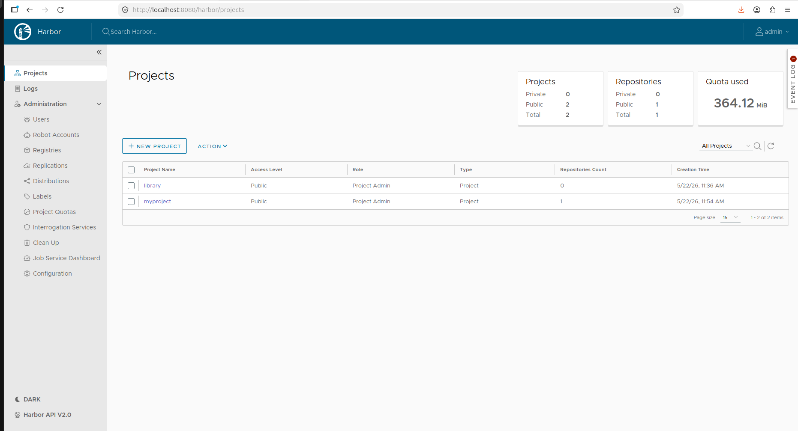

# Installation and Configuration (Simplified Example using Docker Compose):

## Download __docker-compose.yml__ and __harbor.yml__:

Download the necessary configuration files from the Harbor release page on GitHub. Look for the __docker-compose.yml__ and __harbor.yml.tmpl__ (rename this to __harbor.yml__ after customizing).

## Customize harbor.yml:

Edit the __harbor.yml__ file to configure settings like hostname, port, data volume paths, and database passwords.

```yaml
hostname: harbor.local
# http related config
http:
  # port for http, default is 80. If https enabled, this port will redirect to https port
  port: 8080
```
and add it to hosts file.

Comment ssl configuration to use it without certificates:

```yaml
# https related config
#https:
  # https port for harbor, default is 443
  #port: 443
  # The path of cert and key files for nginx
  #certificate: /your/certificate/path
  #private_key: /your/private/key/path
  # enable strong ssl ciphers (default: false)
  # strong_ssl_ciphers: false
```


Run the following command in the directory containing __docker-compose.yml__ and __harbor.yml__ :

    docker-compose up -d

This will download and start all the necessary Docker containers for Harbor.

## Access Harbor:

Open your web browser and navigate to the configured hostname (e.g., https://harbor.local:8080). Log in with the default credentials __(admin/Harbor12345)__. You should change these credentials immediately.


&emsp;


# Using Private Repositories:

## Create a Project:

In the Harbor UI, create a new project (e.g., myproject). Projects provide a namespace for organizing your repositories.




## Add isecure-registry to Docker

Update Docker Configuration

1. You need to add your Harbor domain or IP address to the insecure-registries list in your Docker daemon configuration.

Open /etc/docker/daemon.json (create it if it doesn't exist).

```json
{
  "insecure-registries": ["your-harbor-domain-or-ip:port"]
}
```

Replace your-harbor-domain-or-ip:port with your actual Harbor address, e.g., 192.168.1.100:80 or harbor.local.


2. Restart DockerFor the changes to take effect, you must restart the Docker service.

```
sudo systemctl daemon-reload
sudo systemctl restart docker
```

3.  Verify the Configuration with the command __docker info__


```
...
Experimental: false
Insecure Registries:
harbor.local:8080
::1/128
127.0.0.0/8
Live Restore Enabled: false
...
```


## Configure Docker to Use Harbor:

Log in to the Harbor registry using the Docker CLI:
```
docker login harbor.example.com
```
Enter your username and password.

## Tag and Push Images:

Tag your Docker image with the registry hostname, project name, and repository name:
```
docker tag archlinux:latest harbor.local:8080/myproject/archlinux:latest
```


## Push the image to the Harbor registry:
```
docker push harbor.local:8080/myproject/archlinux:latest
```


## Pull Images:

Pull images from the Harbor registry using the full image name:
```
docker pull harbor.local:8080/myproject/archlinux:latest
```
