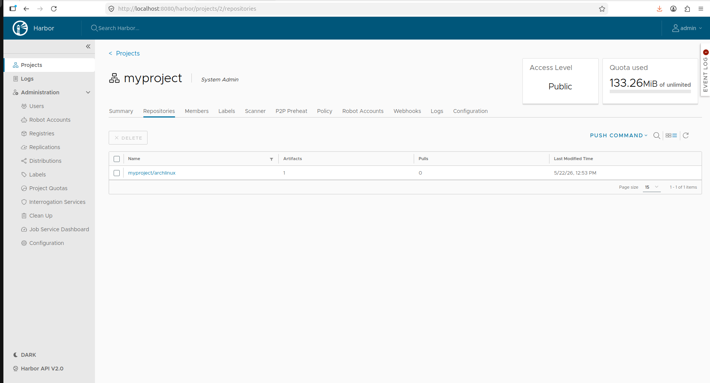

# Prepare host/docker configuration

## Add insecure-registry to Docker

Update Docker Configuration

1. You need to add your Harbor domain or IP address to the insecure-registries list in your Docker daemon configuration.

Open /etc/docker/daemon.json (create it if it doesn't exist).

```json
{
  "insecure-registries": ["core.harbor.domain:1080"]
}
```

This domain and port values will be used to config Harbor access on the localhost (docker port mapping) and the k3d cluster(loadbalancer and ingress rule).

The domain core.harbor.domain hast to be configured (1267.0.0.1) in /etc/hosts.

2. Restart DockerFor the changes to take effect, you must restart the Docker service.

```
sudo systemctl daemon-reload
sudo systemctl restart docker
```

3.  Verify the Configuration with the command __docker info__


```
...
Experimental: false
Insecure Registries:
core.harbor.domain:1080
::1/128
127.0.0.0/8
Live Restore Enabled: false
...
```

# Installation and Configuration (using helm tool):

## Download/Update repo and fetch chart values

helm repo add harbor https://helm.goharbor.io
helm repo update
helm fetch harbor/harbor --untar


## Customize values.yml:

Edit the __values.yml__ file to configure settings like ingress, externalurl, etc.

```yaml
expose:
  # Set how to expose the service. Set the type as "ingress", "clusterIP", "nodePort", "loadBalancer" or "route"
  # and fill the information in the corresponding section
  type: ingress
  tls:
    # Enable TLS or not.
    # Delete the "ssl-redirect" annotations in "expose.ingress.annotations" when TLS is disabled and "expose.type" is "ingress"
    # Note: if the "expose.type" is "ingress" and TLS is disabled,
    # the port must be included in the command when pulling/pushing images.
    # Refer to https://github.com/goharbor/harbor/issues/5291 for details.
    enabled: false
  ... 
  ingress:
    hosts:
      core: core.harbor.domain
    # set to the type of ingress controller if it has specific requirements.
    # leave as `default` for most ingress controllers.
  
# If Harbor is deployed behind the proxy, set it as the URL of proxy
externalURL: http://core.harbor.domain
```

in this case we use ingress type, with an external url with a domain name mapped to 127.0.0.1.

The loadbalancer of the __k3d cluster__ is mapping 1080 to 80 for harbor.
```
image: rancher/k3s:latest
ports:
  - port: 1443:443
    nodeFilters:
      - loadbalancer
  - port: 1080:80
    nodeFilters:
      - loadbalancer
  - port: 8080:8080
    nodeFilters:
      - loadbalancer
```

## Deploy Harbor with helm tool

```
helm install my-harbor harbor/harbor   --namespace harbor   --create-namespace   --values values.yaml
```


## Access Harbor:

Open your web browser and navigate to the configured hostname (e.g., http://core.harbor.domain:1080). Log in with the default credentials __(admin/Harbor12345)__. You should change these credentials immediately.


&emsp;


# Using Private Repositories:

## Create a Project:

In the Harbor UI, create a new project (e.g., myproject). Projects provide a namespace for organizing your repositories.


## Configure Docker to Use Harbor:

Log in to the Harbor registry using the docker cli:
```
luis@pcdev:~/Develop/movi/cicd/scripts/harbor/harbor$ docker login core.harbor.domain:1080
Username: admin
Password: 

WARNING! Your credentials are stored unencrypted in '/home/luis/.docker/config.json'.
Configure a credential helper to remove this warning. See
https://docs.docker.com/go/credential-store/

Login Succeeded
```
Enter your username and password.

## Tag and Push Images:

Tag your Docker image with the registry hostname, project name, and repository name:
```
docker tag archlinux:latest core.harbor.domain:1080/myproject/archlinux:latest
```


## Push the image to the Harbor registry:
```
docker push core.harbor.domain:1080/myproject/archlinux:latest
```


